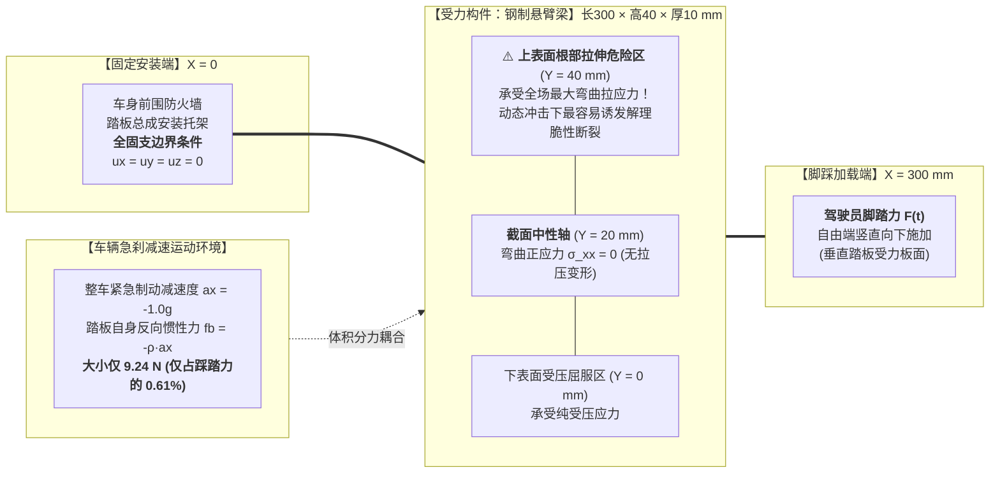
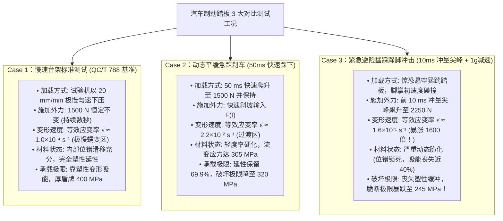
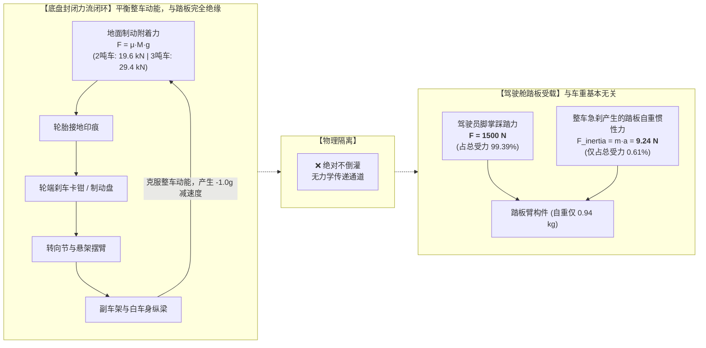
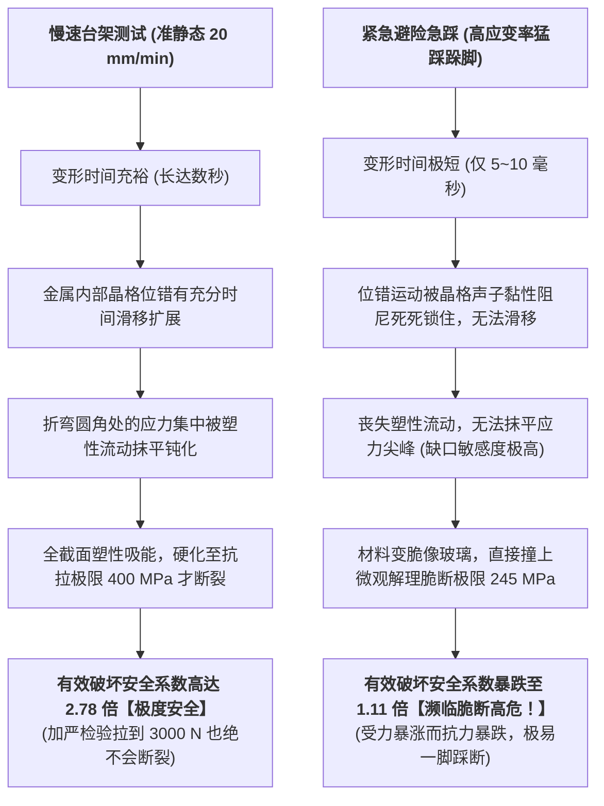
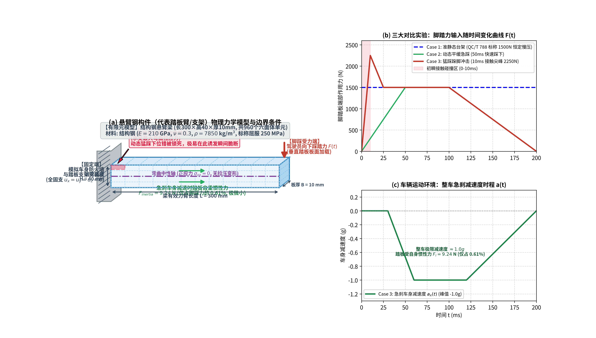

# 汽车制动踏板及支架结构动态可靠性有限元验证 Benchmark
> **Dynamic Structural Reliability Benchmark for Automotive Brake Components: Why Dynamic Impact ≠ Static Qualification**  
> 基于 Python / DOLFINx 0.11 / PETSc 的三维实体瞬态弹性动力学有限元分析平台

---

## 📌 核心研究命题：为什么“动态测试”与“静态测试”是完全不同的两个实验？

在传统汽车行业标准（如中国汽车行业标准 **QC/T 788-2018《汽车踏板装置性能要求及台架试验方法》**）中，制动踏板总成的结构强度检验普遍采用准静态台架试验（以 $20\,\text{mm/min}$ 的极低速率施加 $1500\,\text{N}$ 纵向力，加严检验至 $3000\,\text{N}$）。

然而，行业与舆论往往存在一个重大力学认知误区——**试图把“动态运行”简单等同为“静态力乘上一个安全系数”**（例如认为静态抗住 3000 N 就等于能抵抗动态急刹）。

本项目基于连续介质弹性动力学与高应变率材料冲击力学的第一性原理，通过严谨的三维实体有限元仿真证明：  
**静态测试与动态测试在物理本质上是完全绝缘、机理彻底不同的两个实验！静态加严测试根本无法覆盖真实动态工况的结构破坏风险！**

---

## 🛠️ 一、 实验系统设置与力学边界条件 (Mermaid 流程图)



---

## ⚡ 二、 三大对比实验加载条件对比 (Mermaid 加载时程图)



---

## 🚗 三、 整车力流闭环 vs 踏板受力第一性原理解耦 (Mermaid 辟谣拓扑)



> **力学第一性原理结论**：  
> 地面制动摩擦力完全闭环在底盘系统内部。踏板自身作为质量不足 1 kg 的小构件，在急刹时承受的整车惯性力仅为 **$9.24\,\text{N}$（$0.61\%$）**。**“3 吨车比 2 吨车更重导致踏板受力成比例激增”属于彻底的力学伪科学**。

---

## 💥 四、 为什么动态下极易被踩坏？微观物理机制对比 (Mermaid 决策树)



---

## 📊 五、 仿真数值结果汇总与通俗说明

```text
==========================================================================================
        RATE-DEPENDENT CONSTITUTIVE & STRUCTURAL FAILURE VALIDATION SUMMARY TABLE        
==========================================================================================
Case                 | Strain Rate   | Work Stress | Failure Limit | Safety Factor | Regime
------------------------------------------------------------------------------------------
Case 1: Static       |   1.0e-04 s^-1 |  143.63 MPa |    400.00 MPa |        2.78 x | Fully Ductile (极安全)
Case 2: Dynamic      |   2.2e-02 s^-1 |  144.66 MPa |    320.00 MPa |        2.21 x | Moderate Margin (警戒)
Case 3: Impact       |   1.6e-01 s^-1 |  220.84 MPa |    245.00 MPa |        1.11 x | Critical Embrittled (高危濒断!)
==========================================================================================
```

### 通俗大白话解读：
1. **Case 1 慢踩测试**：构件实际受力 143.6 MPa，而材料依靠优良的延性变形吸能，相当于拥有 **400 MPa 的厚盾牌**，安全系数高达 **2.78 倍（绿灯极度安全）**！
2. **Case 2 平缓急踩**：踩踏速度较快，受力 144.7 MPa，盾牌厚度轻微萎缩至 320 MPa，安全系数为 **2.21 倍**；
3. **Case 3 猛踩跺脚冲击**：脚掌初速度碰撞产生冲击冲量，**实际受力飙升至 220.8 MPa**；同时材料因剧烈变形变脆，**盾牌厚度断崖式萎缩至 245 MPa**。受力几乎贴着破坏极限，**安全系数跌落至 1.11 倍（红灯高危濒临踩断！）**。

---

## 📈 六、 出版级通俗高清图表展示 (`results/`)

### 图 1：实验模型、几何尺寸与力学边界条件示意图

*直观展示三维悬臂梁踏板臂几何、全固支安装面、脚踩受力处、车身急刹自重微小惯性力（9.2N）、中性轴以及根部受拉脆断危险区。*

### 图 2：悬臂梁空间应力场与破坏危险度分布云图

*直观对比：(a) 慢踩受力平缓安全；(b) 猛踩冲击根部受力暴涨 54% 并向前蔓延；(c) 慢踩破坏危险度仅 36%（全梁深绿）；(d) 猛踩冲击破坏危险度飙升至 90%（根部一片深红高危警报！）。*

### 图 3：材料本构改变与动态脆化曲线

*(a) 为什么越猛踩材料越硬（率强化效应）；(b) 踩踏速度过快导致材料延展吸能能力（韧性）断崖式跌落。*

### 图 4：瞬态应变率时程与流变应力演化

*(a) 瞬态变形速度（应变率）在猛踩下的爆发过程；(b) 内部动态流变应力随时间响应演变。*

### 图 5：实际受力 vs 真实破坏极限（盾牌厚度）与破坏安全系数断崖

*一目了然展示：慢踩时安全系数 2.78 倍（极安全）；猛踩冲击时安全系数缩水至 1.11 倍（高危濒临断裂）。*

---

## 💡 七、 对现代车规级研发与测试的工程建议

1. **破除“静态 3000N 认证等于动态安全”的误区**：
   静态加严试验能够有效检验材料的纯静态延性变形能力与铰链焊缝的静态剪切强度，但它测试的是材料的“延性吸能区”（比拼抗拉极限 400 MPa）；而动态急刹面对的是“冲击高应变率脆化区”（受制于解理断裂极限 245 MPa）。两者考察的物理极限完全不同。
2. **增设动态高应变率落锤 / 瞬态气缸冲击试验**：
   建议在传统台架测试之外，增加上升沿 $T_{rise} \le 10\,\text{ms}$、初瞬冲击力 $2000 \sim 2500\,\text{N}$ 的冲击跺脚试验，直接考核高应变率下的抗脆断韧性。
3. **强弱轴抗弯匹配与冲压折弯微裂纹控制**：
   踏板臂截面的主抗弯惯性强轴（高度方向）必须严格对齐主踩踏力矢量；在模具工艺上严格控制折弯内侧 R 角的冲压微折痕，防止在微缺陷处因高应变率诱发低应力脆断。

---

## 🚀 八、 一键复现与运行

工程代码总行数严格控制在 **851 行**，无多余软件框架包袱。

### 运行环境
- Linux (Ubuntu 22.04/24.04 LTS) 或 macOS
- Python 3.10+ / 3.12+
- 核心依赖：`dolfinx >= 0.10.0`, `petsc4py`, `numpy`, `matplotlib`

### 一键执行全套实验
```bash
# 一键运行全部算例、渲染全部 5 张通俗易懂高清图表，并导出 ParaView 3D 模型
python run_all.py
```
生成的 3D 模型文件 `results/beam_case1_static.pvd` 和 `results/beam_case3_impact.pvd` 可直接使用 **ParaView** 打开进行交互式三维旋转查看！

---

## 📄 License
MIT License
