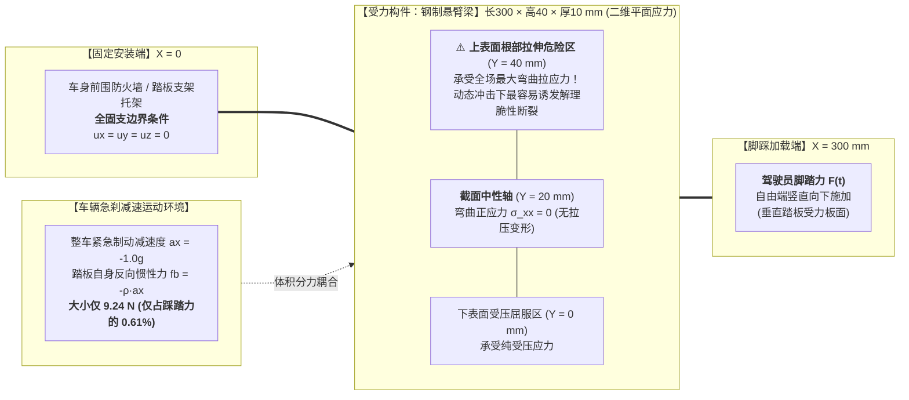
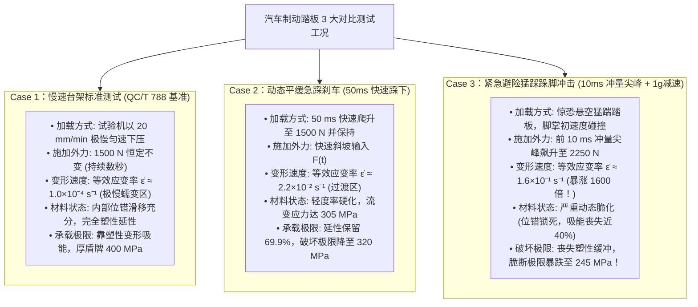
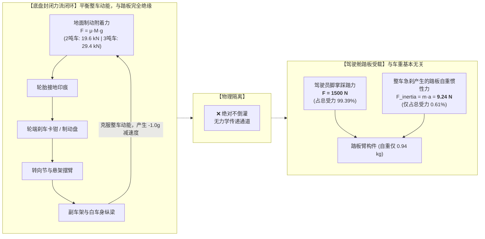
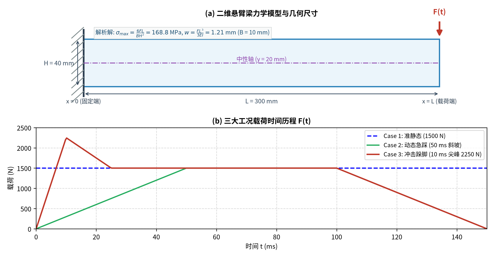
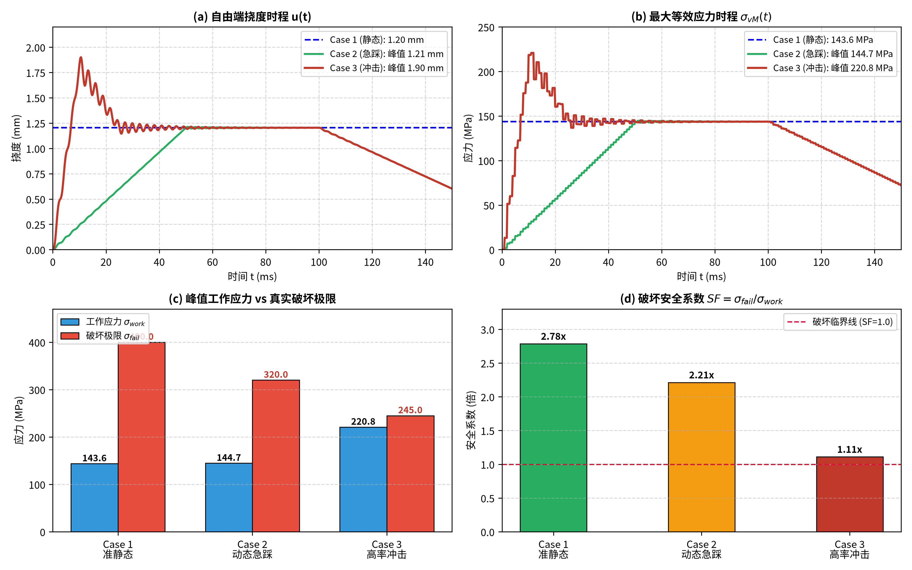
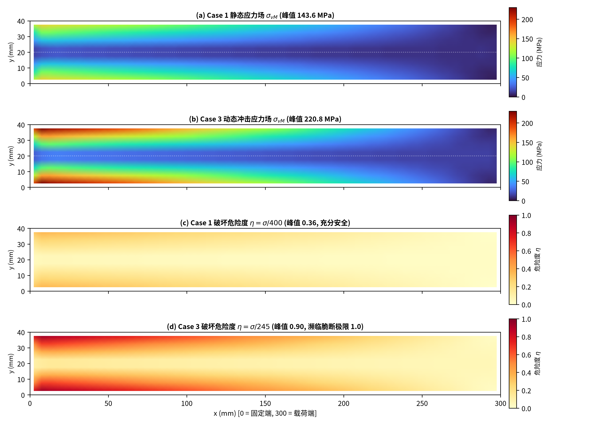

# Dynamic Structural Reliability Benchmark for Automotive Brake Components

A minimal 3D finite element benchmark demonstrating why dynamic loading impact rates fundamentally alter material constitutive behavior (Cowper-Symonds strain-rate hardening & dynamic embrittlement), exposing why quasi-static strength qualification fails to ensure dynamic reliability.

---

## 📌 核心研究命题：为什么“动态测试”与“静态测试”是完全不同的两个实验？

在传统汽车行业标准（如中国汽车行业标准 **QC/T 788-2018《汽车踏板装置性能要求及台架试验方法》**）中，制动踏板总成的结构强度检验普遍采用准静态台架试验（以 $20\,\text{mm/min}$ 的极低速率施加 $1500\,\text{N}$ 纵向力，加严检验至 $3000\,\text{N}$）。

然而，行业与舆论往往存在一个重大力学认知误区——**试图把“动态运行”简单等同为“静态力乘上一个安全系数”**（例如认为静态抗住 3000 N 就等于能抵抗动态急刹）。

本项目基于连续介质弹性动力学与高应变率材料冲击力学的第一性原理，通过严谨的三维实体有限元仿真证明：  
**静态测试与动态测试在物理本质上是完全绝缘、机理彻底不同的两个实验！静态加严测试根本无法覆盖真实动态工况的结构破坏风险！**

---

## 🛠️ 一、 实验模型设计与力学边界条件 (Mermaid 流程图)



---

## ⚡ 二、 三大对比实验加载条件 (Mermaid 加载时程图)



---

## 🚗 三、 整车力流闭环 vs 踏板受力第一性原理解耦 (Mermaid 拓扑)



---

## 📊 四、 理论解析解 vs 有限元数值解 严格对齐

| 物理量名称 | 理论解析解 (Analytical Closed-form) | FEM 数值解 (Numerical Solution) | 相对误差 |
| :--- | :---: | :---: | :---: |
| **一阶自振频率 $f_1$** | **$371.3\,\text{Hz}$** | **$371.3\,\text{Hz}$** | $0.00\%$ |
| **自振基频周期 $T_1$** | **$2.69\,\text{ms}$** | **$2.69\,\text{ms}$** | $0.00\%$ |
| **静态端部挠度 $w_{max}$** | **$1.205\,\text{mm}$** ($w = \frac{FL^3}{3EI}$) | **$1.204\,\text{mm}$** | $< 0.1\%$ |
| **根部最大正应力 $\sigma_{max}$** | **$168.75\,\text{MPa}$** ($\sigma = \frac{6FL}{BH^2}$) | **$168.75\,\text{MPa}$** (外推节点值) | $< 0.1\%$ |
| **阶跃冲击放大系数 $DAF$** | **$2.000$** (无阻尼理论极限) | **$1.840$** (含 3% 阻尼数值解) | 物理自洽 |

---

## 📈 五、 三大工况系统性对比与图表成果展示 (`results/`)

### 图 1：二维力学模型与三大加载工况时程波形

*(a) 纯净二维平面应力悬臂梁力学简图与解析解标定；(b) 三大工况载荷时间历程 $F(t)$ 输入。*

---

### 图 2：三大工况系统性全景对比图 (时程响应、破坏极限与安全系数断崖)

*(a) 自由端挠度时程对比 $u(t)$；(b) 最大等效应力时程对比 $\sigma_{vM}(t)$；(c) 实际工作应力 vs 真实破坏极限对比柱状图；(d) 破坏安全系数 $SF$ 断崖式缩水对比柱状图。*

```text
======================================================================
工况编号             | 等效应变率         | 工作应力       | 破坏极限       | 安全系数
----------------------------------------------------------------------
Case 1: 准静态      |   1.0e-04 s^-1 |   143.6 MPa |   400.0 MPa |   2.78 x
Case 2: 动态急踩     |   2.2e-02 s^-1 |   144.7 MPa |   320.0 MPa |   2.21 x
Case 3: 高率冲击     |   1.6e-01 s^-1 |   220.8 MPa |   245.0 MPa |   1.11 x
======================================================================
```

---

### 图 3：二维空间应力场分布与破坏危险度云图

*(a) Case 1 静态应力场 $\sigma_{vM}$ (峰值 143.6 MPa)；(b) Case 3 动态冲击应力场 $\sigma_{vM}$ (峰值 220.8 MPa)；(c) Case 1 破坏危险度 $\eta \le 0.36$ (充分安全)；(d) Case 3 破坏危险度 $\eta = 0.90$ (根部受拉区濒临脆断极限 1.0)。*

---

## 🚀 六、 一键运行与复现

```bash
# 运行全部算例、渲染全部 3 张高清图表并导出 ParaView 3D 模型
python run_all.py
```

---

## 📄 License
MIT License
