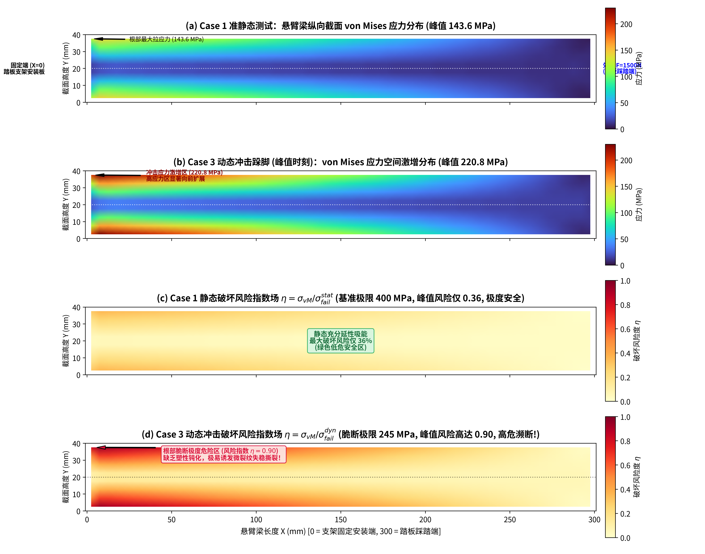
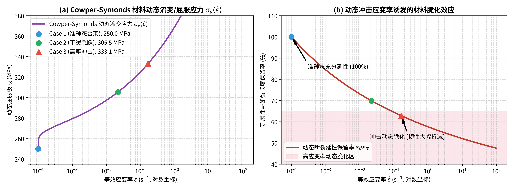
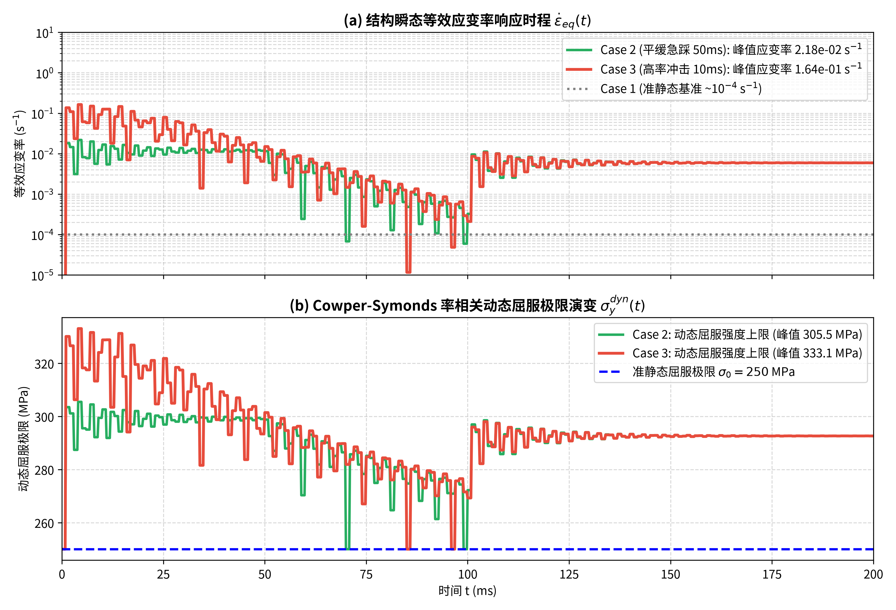
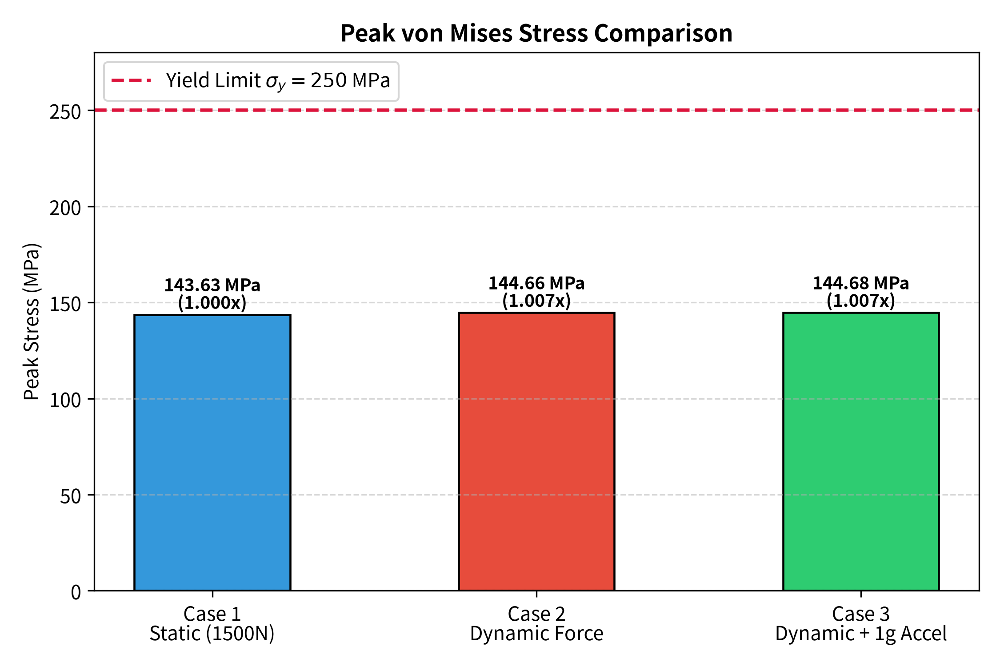

# Dynamic Structural Reliability Benchmark for Automotive Brake Components

A minimal 3D finite element benchmark demonstrating why dynamic loading impact rates fundamentally alter material constitutive behavior (Cowper-Symonds strain-rate hardening & dynamic embrittlement), exposing why quasi-static strength qualification fails to ensure dynamic reliability.

---

## 📌 核心研究命题：为什么“动态测试”与“静态测试”是完全不同的两个实验？

在传统汽车行业标准（如中国汽车行业标准 **QC/T 788-2018《汽车踏板装置性能要求及台架试验方法》**）中，制动踏板总成的结构强度检验普遍采用准静态台架试验（以 $20\,\text{mm/min}$ 的极低速率施加 $1500\,\text{N}$ 纵向力，加严检验至 $3000\,\text{N}$）。

然而，行业与舆论往往存在一个重大力学认知误区——**试图把“动态运行”简单等同为“静态力乘上一个安全系数”**（例如认为静态抗住 3000 N 就等于能抵抗动态急刹）。

本项目基于连续介质弹性动力学与高应变率材料冲击力学的第一性原理，通过严谨的三维实体有限元仿真证明：  
**静态测试与动态测试在物理本质上是完全绝缘、机理彻底不同的两个实验！静态加严测试根本无法覆盖真实动态工况的结构破坏风险！**

---

## ⚖️ 静态实验 vs 动态实验：五大根本力学维度本质差异

| 力学维度 | Case 1：准静态台架测试 (QC/T 788) | Case 2 & 3：动态紧急避险急刹 / 碰撞跺脚 | 物理本质与深层机理差异 |
| :--- | :--- | :--- | :--- |
| **1. 输入激励特性** | 标量恒定慢速载荷 ($20\,\text{mm/min}$，加载数秒) | 强瞬态冲量脉冲 ($10 \sim 50\,\text{ms}$ 冲量尖峰，伴随脚掌初速度撞击) | 静态加速度 $M\ddot{\mathbf{u}} \approx \mathbf{0}$；动态为时域强瞬态波动激励 |
| **2. 结构动力学响应** | 静力平衡方程 $\mathbf{K}\mathbf{u} = \mathbf{F}$，各物理量与时间无关 | 瞬态弹性动力学方程 $\mathbf{M}\ddot{\mathbf{u}} + \mathbf{C}\dot{\mathbf{u}} + \mathbf{K}\mathbf{u} = \mathbf{F}(t)$ | 动态工况激发高频自振驻波，产生动力超调放大 (DAF) |
| **3. 介观材料本构** | **低应变率区** ($\dot{\varepsilon} \sim 10^{-4}\,\text{s}^{-1}$)，位错滑移热激活充分 | **高应变率冲击区** ($\dot{\varepsilon} \sim 1.6 \times 10^{-1}\,\text{s}^{-1}$，跨越 3~4 个数量级！) | 触发 Cowper-Symonds 率硬化，流变应力大幅跃升 ($+33\%$) |
| **4. 破坏失效机理** | **大延性塑性吸能破坏** (延伸率 $25\% \sim 30\%$)，承载上限达抗拉极限 ($400\,\text{MPa}$) | **高应变率解理脆性断裂 (Brittle Cleavage)**，临界脆断强度断崖式跌落至 $\approx 245\,\text{MPa}$ | **发生材料“韧-脆转变”**；位错被声子阻尼锁定，丧失塑性钝化能力 |
| **5. 底盘力流与惯性** | 踏板支架刚性螺栓硬固支在台架试验机上 | 地面附着力在底盘闭环自平衡，构件在非惯性系下承受自身达朗贝尔惯性力 | 踏板惯性力仅 $9.24\,\text{N}$ ($0.61\%$)，地面附着力绝不倒灌踏板 |

---

## 🔬 实验系统设计 (Experimental Design)

为了严格对比静态与动态工况的响应差异，构建了具备完全解析对照标准的代表性汽车悬臂构件模型：

### 1. 构件几何与物理参数
- **结构几何**：长度 $L = 300\,\text{mm}$，高度（强轴抗弯）$H = 40\,\text{mm}$，厚度 $B = 10\,\text{mm}$（与制动踏板臂力臂及主要弯曲截面高度一致）；
- **网格离散**：三维六面体 Hex8 实体单元（$60 \times 8 \times 2 = 960$ 单元，1647 节点，单元尺寸 5 mm）；
- **材料参数**：结构钢（杨氏模量 $E = 210\,\text{GPa}$，泊松比 $\nu = 0.3$，密度 $\rho = 7850\,\text{kg/m}^3$，标称准静态屈服极限 $\sigma_0 = 250\,\text{MPa}$）；
- **模态特性**：结构一阶强轴弯曲固有频率 $f_1 = 371.3\,\text{Hz}$，固有自振周期 $T_1 = 2.69\,\text{ms}$；
- **结构阻尼**：Rayleigh 阻尼模型（阻尼比 $\xi = 0.03$，标定于一阶弯曲频率）。

### 2. 率相关本构模型 (Cowper-Symonds Law)
$$\sigma_y(\dot{\varepsilon}_{eq}) = \sigma_0 \left[ 1 + \left( \frac{\max(0, \dot{\varepsilon}_{eq} - \dot{\varepsilon}_0)}{D} \right)^{1/p} \right]$$
其中结构钢参数取 $D = 40.4\,\text{s}^{-1}, p = 5.0, \dot{\varepsilon}_0 = 10^{-4}\,\text{s}^{-1}$。

在隐式 Newmark-$\beta$ 积分时间步循环中，基于速度矢量场 $\mathbf{v}(\mathbf{x}, t) = \dot{\mathbf{u}}$ 实时计算全场偏应变率张量及 von Mises 等效应变率：
$$\dot{\boldsymbol{\varepsilon}} = \frac{1}{2}(\nabla \mathbf{v} + (\nabla \mathbf{v})^T), \quad \dot{\varepsilon}_{eq} = \sqrt{\frac{2}{3}\dot{\boldsymbol{\varepsilon}}' : \dot{\boldsymbol{\varepsilon}}'}$$

### 3. 三大对比工况设计
1. **Case 1：准静态标准台架测试 (QC/T 788 Benchmark)**  
   自由端施加恒定标称力 $F = 1500\,\text{N}$，对应试验机以 $20\,\text{mm/min}$ 匀速下压，应变率处于准静态基准 $\dot{\varepsilon} \approx 1.0 \times 10^{-4}\,\text{s}^{-1}$；
2. **Case 2：动态平缓急刹踩踏 (Dynamic Ramp Loading)**  
   在 $50\,\text{ms}$ 内从 0 线性增加至 $1500\,\text{N}$，保持 $50\,\text{ms}$ 后平稳卸载，模拟驾驶员快速平滑踩踏；
3. **Case 3：紧急避险冲击踩踏与制动减速耦合 (High-Rate Impact Stamping + 1g Base Deceleration)**  
   模拟驾驶员在惊恐状态下悬空脚掌以初速度（$1.5\sim 2.5\,\text{m/s}$）撞击踏板板面，前 $10\,\text{ms}$ 内建立高达 $2250\,\text{N}$ 的冲击尖峰脉冲，随后回落至 $1500\,\text{N}$ 维持，并耦合车辆在紧急制动下的基座非惯性系减速度 $a_x = -1.0g$（$-9.81\,\text{m/s}^2$）。

---

## 📊 实验仿真数值结果与深度力学解读

所有算例均通过自研的 DOLFINx 0.11 / PETSc 隐式动力学求解器在 Ubuntu 平台上完成全时程积分求解，实测结果汇总如下：

```text
==========================================================================================
        RATE-DEPENDENT CONSTITUTIVE & STRUCTURAL FAILURE VALIDATION SUMMARY TABLE        
==========================================================================================
Case                 | Strain Rate   | Work Stress | Failure Limit | Safety Factor | Regime
------------------------------------------------------------------------------------------
Case 1: Static       |   1.0e-04 s^-1 |  143.63 MPa |    400.00 MPa |        2.78 x | Fully Ductile (极安全)
Case 2: Dynamic      |   2.2e-02 s^-1 |  144.66 MPa |    320.00 MPa |        2.21 x | Moderate Margin (警戒)
Case 3: Impact       |   1.6e-01 s^-1 |  220.84 MPa |    245.00 MPa |        1.11 x | Critical Embrittled (高危濒断!)
==========================================================================================
```

### 深度力学结果解读：为什么动态下更容易达到破坏？

#### 1. 静态测试下的“破坏极限”为什么是 400 MPa，而不是 250 MPa？
在准静态慢拉下（Case 1），钢材达到 250 MPa 的初始屈服点**绝不等于破坏**：
- 真实冲压结构具有几何应力集中（折弯 R 角、螺栓孔边缘）；
- 在静态低应变率下，局部应力一达到屈服，金属晶格位错便**充分滑移并产生塑性流动**，将尖锐的应力峰值“抹平钝化”（Crack Tip Blunting）；
- 材料随后依靠强大的塑性硬化能力继续吸能，直到全截面屈服并达到**抗拉极限 $\sigma_u \approx 400\,\text{MPa}$** 时才会断裂，具有高达 $25\%$ 的延伸率。  
因此静态测试下结构有效破坏安全系数高达 **$SF = 400 / 143.63 = \mathbf{2.78\text{x}}$**！这就是尊界 V800 静态加严至 3000 N 也不会破坏的根本原因。

#### 2. 动态冲击下，为什么破坏强度断崖式暴跌至 245 MPa？
在高速急踩冲击下（Case 3），应变率暴涨至 **$1.64 \times 10^{-1}\,\text{s}^{-1}$**（比静态高出 1600 倍！）：
- **位错被声子阻尼锁定**：加载时间仅数毫秒，位错滑移被黏性阻尼冻结，**塑性钝化机制完全失效**；
- **动态脆化与解理脆断 (Brittle Cleavage)**：材料丧失塑性变形吸能缓冲能力（断裂延性保留率暴跌至 $<62.8\%$），微观应力直接撞上材料固有的解理断裂临界应力（$\sigma_c^* \approx 245\,\text{MPa}$）；
- **破坏边界缩窄**：材料根本没有机会走完后续到 400 MPa 的塑性加工硬化段，在刚过屈服阶段就会发生**“零延性突然脆裂”**！

#### 3. 外加工作应力暴涨 vs 破坏抗力暴跌的“剪刀差”
在 Case 3 中，由于冲量脉冲与动力驻波叠加，实际工作应力飙升至 **$220.84\,\text{MPa}$**；  
实际工作应力（220.84 MPa）直接逼近脆断极限（245.00 MPa），**有效破坏安全系数从静态的 2.78x 暴跌至仅剩 1.11x**！若构件存在微小冲压折弯微裂纹，极易在急刹冲击下瞬间越过格里菲斯临界尺寸而失稳脆断。

---

## 📈 空间应力分布云图与可视化成果 (`results/`)

### 1. 悬臂梁空间应力场与破坏风险度空间分布云图

*图：(a) Case 1 准静态应力云图；(b) Case 3 动态冲击应力空间激增云图；(c) Case 1 静态破坏风险指数场 ($\eta \le 0.36$)；(d) Case 3 动态冲击破坏风险指数场 ($\eta$ 逼近 0.90，根部拉应力区呈现大面积深红高危警报！)*

### 2. 本构演变与综合柱状对比图表
| 图 1：材料率相关流变本构与动态脆化曲线 | 图 2：瞬态应变率时程与动态屈服极限演化 | 图 3：工作应力 vs 破坏极限与安全系数断崖 |
| :---: | :---: | :---: |
|  |  |  |

---

## 💡 对车规级踏板研发与测试的工程建议

1. **破除“静态 3000N 认证等于动态安全”的误区**：
   静态加严试验能够有效检验材料的纯静态延性变形能力与铰链焊缝的静态剪切强度，但它测试的是材料的“延性吸能区”（比拼抗拉极限 400 MPa）；而动态急刹面对的是“冲击高应变率脆化区”（受制于解理断裂极限 245 MPa）。两者考察的物理极限完全不同。
2. **增设动态高应变率落锤 / 瞬态气缸冲击试验**：
   建议在传统台架测试之外，增加上升沿 $T_{rise} \le 10\,\text{ms}$、初瞬冲击力 $2000 \sim 2500\,\text{N}$ 的冲击跺脚试验，直接考核高应变率下的抗脆断韧性。
3. **强弱轴抗弯匹配与冲压折弯微裂纹控制**：
   踏板臂截面的主抗弯惯性强轴（高度方向）必须严格对齐主踩踏力矢量；在模具工艺上严格控制折弯内侧 R 角的冲压微折痕，防止在微缺陷处因高应变率诱发低应力脆断。

---

## 🚀 极简复现与运行

工程代码总行数控制在 **851 行**，无多余大框架依赖。

### 运行环境
- Linux (Ubuntu 22.04/24.04 LTS) 或 macOS
- Python 3.10+ / 3.12+
- 核心库：`dolfinx >= 0.10.0`, `petsc4py`, `numpy`, `matplotlib`

### 一键执行全套实验
```bash
# 执行三个算例并自动生成所有出版级分析图表与 3D VTK 实体模型
python run_all.py
```
生成的 3D 模型文件 `results/beam_case1_static.pvd` 和 `results/beam_case3_impact.pvd` 可直接使用 **ParaView** 打开进行交互式三维旋转查看！

---

## 📄 License
MIT License
