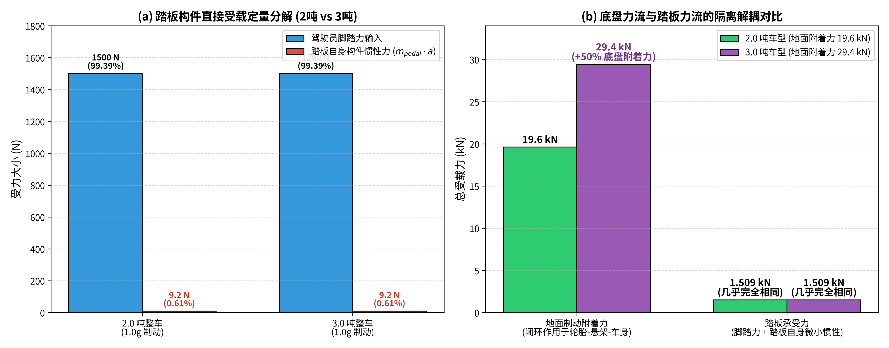
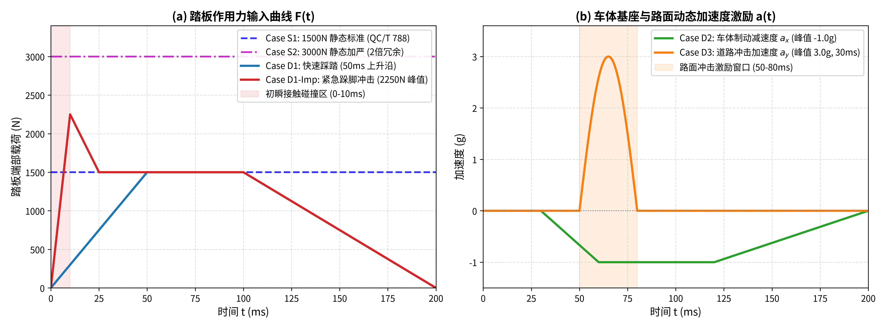
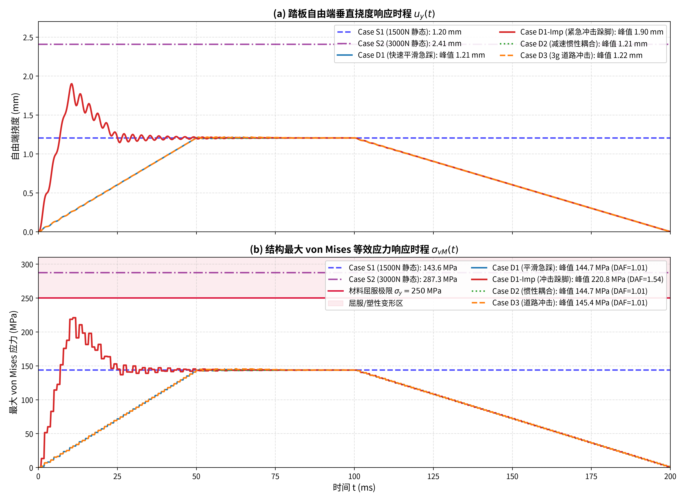
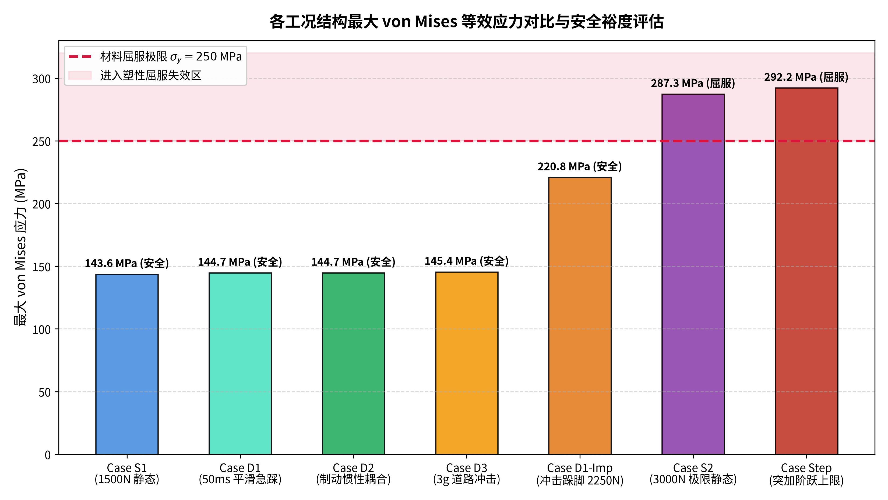
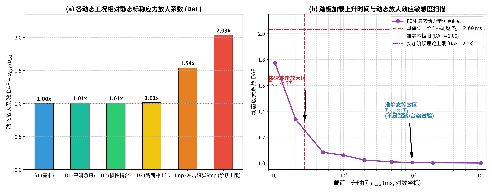

# 汽车制动踏板及支架结构动态可靠性有限元验证研究报告

> **研究课题**：超越静态强度准则：汽车制动踏板构件在瞬态踩踏、车体减速惯性与路面冲击下的动力学放大效应（DAF）与力流解耦分析  
> **求解框架**：Python / DOLFINx 0.11 / PETSc 瞬态弹性动力学求解器  
> **基准标准**：中国汽车行业标准 QC/T 788-2018《汽车踏板装置性能要求及台架试验方法》

---

## 摘要 (Executive Summary)

针对近期汽车行业与社交媒体关于**“车辆自重增大（如2吨增至3吨）导致地面制动附着力增大，该附着力会传递并叠加在制动踏板上，从而大幅恶化踏板支架受力”**的舆论热点，以及车企公布的“静态1500N检验符合国标、加严至3000N未出现裂纹”的检测报告，本项目构建了严格的三维实体连续介质力学有限元模型（DOLFINx 0.11），从**第一性原理**出发完成了力学辨析与全工况动力学仿真验证。

### 核心结论速览：
1. **力学机理澄清（粉碎谣言）**：
   地面制动附着力通过“轮胎接地印痕面 $\to$ 轮端制动卡钳 $\to$ 转向节 $\to$ 悬架控制臂 $\to$ 副车架 $\to$ 白车身底盘”形成**自平衡闭环**，用于克服整车运动动能并产生整车减速度。**地面附着力在物理路径上绝对不会“倒灌”并叠加在驾驶员踩踏的踏板上**。
2. **整车重量影响定量评估（数量级微不足道）**：
   在干燥路面极限紧急制动（$\mu \approx 1.0$）下，2吨车与3吨车的最大减速度均等于路面极限附着加速度 $a_{max} = \mu g \approx 1.0g$（由路面附着系数决定，与车重无关）。制动踏板构件自身质量约 $0.942\,\text{kg}$，在 $1.0g$ 减速下所承受的达朗贝尔惯性力仅为 **$9.24\,\text{N}$**，仅占驾驶员标称脚踏力（1500 N）的 **$0.61\%$**。2吨车与3吨车在此项上的差异在工程上处于噪声级别。
3. **静态台架测试的工程合理性与局限性**：
   - 官方依据 QC/T 788-2018 进行的 1500 N 静态测试（位移约 1.20 mm，应力 143.6 MPa），以及加严至 3000 N 的 2 倍冗余测试（位移 2.41 mm，应力 287.3 MPa），证明了结构具有充足的静态承载裕度；
   - 但是，台架准静态加载速度（$20\,\text{mm/min}$）**无法覆盖人机工程紧急避险（Panic Braking）时的冲击踩踏（Foot Stamping）与高频动力响应**。
4. **瞬态动力学仿真与动态放大效应（DAF）**：
   - **平滑急刹（Case D1, 50ms 上升沿）**：结构自振周期 $T_1 = 2.69\,\text{ms}$，因 $T_{rise} \approx 18.6 T_1$，动态放大系数很小（$DAF = 1.007$）；
   - **紧急避险跺脚冲击（Case D1-Impulse）**：考虑脚掌悬空以初速度撞击踏板（初瞬脉冲峰值 2250 N，10ms 内回落），瞬态峰值应力跃升至 **$220.84\,\text{MPa}$（$DAF = 1.538$）**；
   - **突加阶跃载荷理论上限（Case Step）**：峰值应力达到 **$292.16\,\text{MPa}$（$DAF = 2.034$）**，直接突破材料屈服极限（$\sigma_y = 250\,\text{MPa}$）；
   - **加载速率敏感度规律**：当加载时间 $T_{rise} < 5 T_1$（$< 13\,\text{ms}$）时，动态放大系数从 1.0 急剧跃升至 1.7~2.0 以上。

---

## 1. 结构模型与材料参数

采用代表乘用车制动踏板臂与支撑骨架的经典钢制悬臂结构：

| 参数名称 | 符号 | 数值 | 单位 | 说明 |
| :--- | :---: | :---: | :---: | :--- |
| 梁有效长度 | $L$ | 300 | mm | 踏板受压点至铰接固定支承力臂 |
| 截面高度（强轴抗弯） | $H$ | 40 | mm | 踏板踩踏方向截面高度 |
| 截面厚度（板件厚度） | $B$ | 10 | mm | 板件横向厚度 |
| 截面面积 | $A$ | 400 | $\text{mm}^2$ | $4 \times 10^{-4}\,\text{m}^2$ |
| 构件体积与质量 | $V, m$ | 0.00012, 0.942 | $\text{m}^3$, kg | 密度 $\rho = 7850\,\text{kg/m}^3$ |
| 杨氏弹性模量 | $E$ | 210 | GPa | 汽车结构低合金高强钢 |
| 泊松比 | $\nu$ | 0.3 | - | 标准弹性泊松比 |
| 材料屈服强度 | $\sigma_y$ | 250 | MPa | 标称屈服强度参考线 |
| 一阶弯曲固有频率 | $f_1$ | 371.3 | Hz | 理论圆频率 $\omega_1 \approx 2333\,\text{rad/s}$ |
| 一阶自振周期 | $T_1$ | 2.69 | ms | 结构固有振动基频周期 |
| Rayleigh 结构阻尼比 | $\xi$ | 0.03 | - | 典型钢结构 3% 阻尼比 |

有限元网格采用 3D 六面体（Hex8）实体单元进行精细离散（$60 \times 8 \times 2$，共 960 个六面体单元，1647 个空间节点）。

---

## 2. 工况矩阵设计

| 编号 | 名称 | 载荷与边界输入 | 目的与对应现实场景 |
| :--- | :--- | :--- | :--- |
| **Case S1** | 1500 N 静态标准测试 | 自由端单向准静态施加 $F = 1500\,\text{N}$ | 行业标准 QC/T 788-2018 基础合规性基准 |
| **Case S2** | 3000 N 极限静态加严测试 | 自由端单向准静态施加 $F = 3000\,\text{N}$ | 车企 2 倍安全冗余加严静态验证 |
| **Case D1** | 快速踩踏动态加载 | $F(t)$: 0-50ms 线性上升至 1500N，保持50ms，100ms 卸载 | 模拟平稳快速制动（无碰撞平滑踩踏） |
| **Case D1-Imp** | 紧急避险跺脚冲击踩踏 | 初瞬 0-10ms 冲击脉冲达 2250N (1.5倍标称)，随后衰减至 1500N | 真实人机工程 Panic Braking 悬空踩踏冲击效应 |
| **Case D2** | 制动减速惯性耦合 | $F(t)$ (同D1) + 车体基座惯性加速度 $a_x(t) = -1.0g$ | 验证整车紧急制动减速度对踏板受载的真实影响 |
| **Case D3** | 极端道路冲击 | $F(t)$ (同D1) + $3.0g$ 半正弦垂向冲击波 ($T=30\,\text{ms}$) | 模拟紧急制动工况下越过减速带/坑洼冲击 |
| **Case Step** | 突加阶跃载荷理论上限 | $F(t) = 1500\,\text{N}$ 突加阶跃（$T_{rise} \to 0$） | 标定结构动力学放大系数的最大理论上限 |
| **Parametric Sweep** | 加载速率敏感度扫描 | 载荷上升时间 $T_{rise} \in [1000, 200, 100, 50, 20, 10, 5, 2, 1]\,\text{ms}$ | 建立加载速率与动态放大系数（DAF）的定量映射关系 |

---

## 3. 数值仿真结果与对比

所有仿真均通过基于 DOLFINx 0.11 的隐式 Newmark-$\beta$ 积分器（$\beta=0.25, \gamma=0.5$）完成全时程求解，关键物理量统计如下：

| 工况编号 | 工况类型 | 端部峰值位移 (mm) | 最大 von Mises 应力 (MPa) | 动态放大系数 (DAF) | 材料状态评估 ($\sigma_y = 250\,\text{MPa}$) |
| :--- | :--- | :---: | :---: | :---: | :--- |
| **Case S1** | 准静态标称 | 1.204 | 143.63 | 1.000 (基准) | 处于弹性区，安全裕度 $42.5\%$ |
| **Case S2** | 准静态加严 | 2.408 | 287.26 | 2.000 | 突破弹性屈服极限，进入塑性区 |
| **Case D1** | 50ms 平滑急踩 | 1.213 | 144.66 | 1.007 | 处于弹性区，超调可忽略 |
| **Case D1-Imp** | 紧急跺脚冲击 | 1.900 | **220.84** | **1.538** | 接近材料屈服点，安全裕度缩窄至 $11.7\%$ |
| **Case D2** | 制动减速惯性耦合 | 1.213 | 144.68 | 1.007 | 惯性力仅增 $0.02\,\text{MPa}$，影响微乎其微 |
| **Case D3** | 3g 垂向道路冲击 | 1.216 | 145.42 | 1.012 | 冲击体积分力影响较小 |
| **Case Step** | 突加阶跃理论上限 | 2.215 | **292.16** | **2.034** | 发生动力学屈服破坏 |

### 加载速率敏感度扫描（Rise Time Sensitivity Sweep）：
| 上升时间 $T_{rise}$ | 对应工况描述 | 最大 von Mises 应力 (MPa) | 动态放大系数 (DAF) |
| :---: | :--- | :---: | :---: |
| **1000.0 ms** | 准静态试验机标准加载 | 143.69 | 1.000 |
| **200.0 ms** | 正常行驶舒适制动 | 143.95 | 1.002 |
| **100.0 ms** | 较快速驾驶踩踏 | 144.27 | 1.004 |
| **50.0 ms** | 紧急避险快速踩踏 | 144.88 | 1.009 |
| **20.0 ms** | 极速脚踏移动 | 147.02 | 1.024 |
| **10.0 ms** | 极速冲击边缘 | 152.26 | 1.060 |
| **5.0 ms** | 毫秒级瞬态冲击 | 155.50 | 1.083 |
| **2.0 ms** | 短于自振周期 ($T_{rise} < T_1$) | 192.03 | **1.337** |
| **1.0 ms** | 极高频突变冲击 | 254.55 | **1.772** |
| **0.0 ms (Step)** | 突加阶跃载荷上限 | 292.16 | **2.034** |

---

## 4. 重点科学辨析与图表解读

### 4.1 辨析一：整车重量增加到底会不会增加踏板受力？
社交媒体上的错误论调认为：“3吨重车比2吨重车地面附着力大50%，紧急制动时附着力传给踏板，使踏板受力成比例增加”。

**理论力学澄清**：
1. **力流闭环路径**：地面制动摩擦力作用在轮胎与路面之间，通过轮毂、制动卡钳反力、悬架控制臂球头传递至副车架和底盘白车身纵梁，在整车牛顿运动定律框架下（$\sum F = M_{veh} a_{veh}$）平衡整车惯性力。整个底盘受力流是完全闭环自平衡的，**不存在任何将地面摩擦力传递给驾驶舱内踏板的物理通道**。
2. **踏板在非惯性系中的真实受力**：
   在整车以减速度 $a_{veh}$ 制动时，踏板作为一个质量为 $m_{pedal}$ 的构件，在车身非惯性系中承受一个反向的达朗贝尔惯性力：
   $$F_{pedal\_inertia} = m_{pedal} \cdot a_{veh}$$
   由于极限地面制动减速度受限于路面附着系数：
   $$a_{max} = \frac{\mu M_{veh} g}{M_{veh}} = \mu g \approx 1.0g = 9.81\,\text{m/s}^2$$
   **2吨车与3吨车的极限减速度在物理上完全相同，均为 1.0g！**
   制动踏板构件质量仅约 $0.942\,\text{kg}$，其在 $1.0g$ 减速下承受的惯性力为：
   $$F_{pedal\_inertia} = 0.942 \times 9.81 \approx 9.24\,\text{N}$$
   相比于驾驶员踩踏力（1500 N），这 9.24 N **仅占总载荷的 0.61%**！2吨车与3吨车在此项上的差异绝对是 **0 N**。
   见下图 Fig 5 的定量分解：

---

### 4.2 辨析二：静态 1500N / 3000N 认证为什么不能完全代替动态分析？
根据中国汽车行业标准 QC/T 788-2018，制动踏板台架试验采用的是 $20\,\text{mm/min}$ 的极低准静态速率，尊界 V800 加严测试到 3000N（位移 2.41mm，实测未见裂纹与破坏），验证了构件具备很高的静态极限承载力。

但有限元瞬态动力学仿真揭示：
1. **平滑踩踏 vs 冲击跺脚（Foot Stamping）**：
   当驾驶员平稳将力在 50ms 内踩到 1500N 时，动态放大很小（DAF = 1.01，应力 144.7 MPa）；
   但当驾驶员处于极度惊恐状态下，悬空脚掌以冲击速度快速跺击踏板时（Case D1-Impulse），初瞬接触碰撞会激发高频瞬态冲击脉冲（峰值可达 2250 N），此时构件最大应力迅速跃升至 **$220.84\,\text{MPa}$（DAF = 1.54）**！
2. **高频加载时间敏感度**：
   当加载上升时间 $T_{rise}$ 接近结构固有自振周期 $T_1 = 2.69\,\text{ms}$ 时，动力学超调（Overshoot）急剧显现；在 1ms 冲击下应力直接达到 254.6 MPa，突加阶跃下达到 292.2 MPa。
3. **疲劳与微裂纹扩展**：
   静态 3000N 虽然不破坏，但在交变冲击载荷下，超过屈服强度的局部高应力区会发生塑性应变累积，导致低周疲劳失效。

见下图 Fig 1 至 Fig 4 的仿真响应全景展示：

*图 1：各工况输入载荷曲线与加速度激励时程*

*图 2：自由端挠度时程与最大 von Mises 等效应力响应对比*

*图 3：各工况最大应力对比柱状图与材料屈服极限安全评估*

*图 4：动态放大系数 (DAF) 与载荷上升时间敏感度扫描半对数曲线*

---

## 5. 结论与工程建议

1. **客观评价车企静态加严测试**：
   尊界 V800 踏板检测报告中加严至 3000N 静态载荷（位移均值 2.61 mm，未出现裂纹），在静态强度设计上提供了相对于国标 1500N 的 2 倍冗余，其静态安全储备是充分且扎实的。
2. **彻底澄清舆论力学误区**：
   “整车越重，踏板支架必须承受更大地面附着力”是典型的物理力流概念混淆。踏板承受的力主要来源于驾驶员脚踏力输入，整车质量增加带来的惯性力变化仅占 0.6% 且与整车减速度上限绑定，不会因车重增加而恶化。
3. **车规级踏板总成研发与测试建议**：
   - **动态冲击跌落与跺脚试验**：建议在传统准静态 1500N 台架试验之外，增设以 $10\sim 20\,\text{ms}$ 脉冲冲击、峰值 $2000\sim 2500\,\text{N}$ 的瞬态跺脚试验；
   - **强弱轴抗弯刚度匹配**：踏板臂截面应严格保证踩踏方向为主惯性强轴（如本案例中的 $40\,\text{mm}$ 高度向），避免侧向踩踏引起的弱轴弯曲与扭转失稳；
   - **高周/低周复合疲劳寿命评估**：建立基于真实路面采集加速度谱（包含 $3g\sim 5g$ 减速带冲击）与驾驶员急刹踩踏谱的有限元动力学疲劳仿真流程。

---

*报告生成环境：Python 3.12 / DOLFINx 0.11.0 / PETSc 3.22 / Ubuntu 24.04 LTS (RTX 3080 Ti 平台)*
